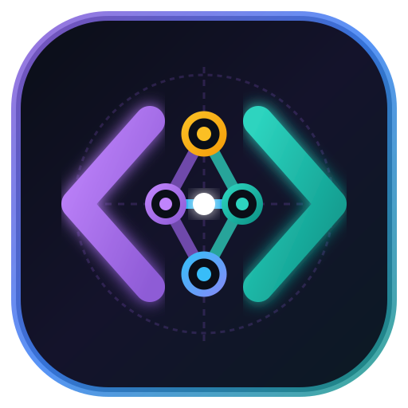
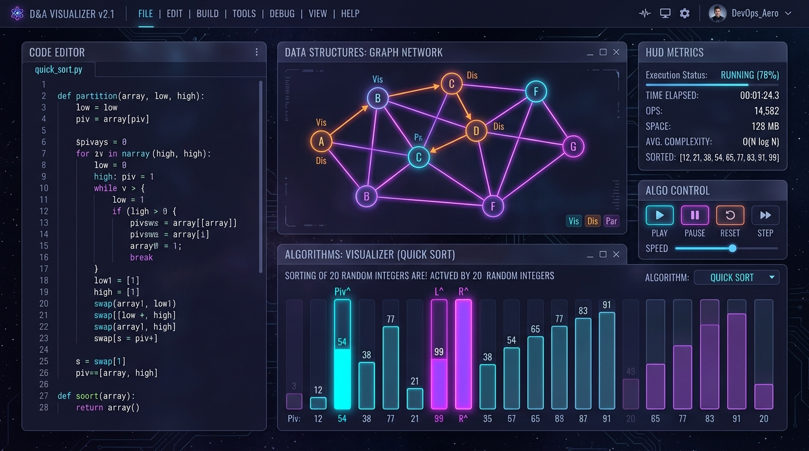

<div align="center">



# ⚡ ThinkCode
### Interactive Data Structures & Algorithms Visualizer & Dual-Engine Code Tracer

> **Watch Algorithms Think & Execute.**  
> A high-performance, zero-dependency browser playground built for Computer Science & IT students to dissect memory mutations, pointers, recursion call stacks, and execution flows in real time.

[](https://tahirmansuri.github.io/ThinkCode/)
[](LICENSE)
[](https://pyodide.org/)
[](cpp-tracer.js)
[](js/)

<br>



<br><br>

[✨ Key Features](#-key-features) • [⚡ Dual Tracers](#-in-browser-dual-engine-code-tracers) • [📊 Supported DSA](#-algorithm--data-structure-matrix) • [🚀 Quick Start](#-quick-start) • [👤 Author](#-author) • [📄 License](#-license)

---

</div>

## 🌟 Why ThinkCode?

Most online code runners execute scripts on a remote server and return static terminal output. **ThinkCode** operates differently: it runs **100% inside your browser** and inspects every atomic micro-step of memory, pointers, and variables as code executes.

| Feature | Generic Online Compilers | Standard Visualizers | ⚡ ThinkCode |
| :--- | :---: | :---: | :---: |
| **Server Latency** | 300ms – 2s | N/A | **0ms (Instant Local JS / WASM)** |
| **Step-by-Step Code Tracing** | ❌ No | ❌ Pre-baked | **✅ Yes (Arbitrary Student Code)** |
| **Active Call Stack Frames** | ❌ No | ⚠️ Rare | **✅ Real-Time Stack Tree** |
| **Variables Mutation Watch** | ❌ No | ⚠️ Static | **✅ Real-Time Change Highlights** |
| **Multi-Language Support** | Varies | Usually 1 | **✅ Python 3.12 + C++ Engine** |
| **Sound Synthesis Engine** | ❌ No | ❌ No | **✅ Web Audio Harmonic Synths** |
| **Zero Backend Setup** | ❌ Requires Server | ⚠️ Often needs Node | **✅ Pure Client-Side Static App** |

---

## ✨ Key Features

- **⚡ Dual-Engine Code Tracers:**
  - **C++ Step Tracer:** Ultra-lightweight in-browser interpreter. Zero download, 0ms startup, traces vectors, recursion, arrays, pointers-by-reference (`&`), `cout`, and `cin`.
  - **Python Step Tracer:** Powered by Pyodide (Python 3.12 compiled to WebAssembly). Full syntax execution with standard input and formatted outputs.
- **🔍 Deep Memory & State Inspection:**
  - **Line Highlight:** Real-time visual cursor indicating which statement is executing.
  - **Variables Watch Table:** Dynamically detects and highlights variables that change values during loops or recursion.
  - **Call Stack Frame Viewer:** Step into and out of nested function calls, inspecting local variables per stack level.
  - **Virtual Console:** Streams `stdout` step-by-step as each `cout` or `print()` fires.
- **🎨 Modern Cyberpunk / High-Tech UI:**
  - Responsive multi-theme engine: **Midnight**, **Dark**, **Light**, and **Paper**.
  - Futuristic holographic cards with dynamic tilt and cyber scanlines.
- **🔊 Web Audio API Sound Engine:**
  - Audio frequencies mapped harmonically to array swaps, traversals, and recursive depths.

---

## ⚡ In-Browser Dual-Engine Code Tracers

### 1. C++ Interpreter (`cpp-tracer.js`)
Runs instantly with zero download time. Designed to teach foundational systems programming concepts:
- **Data Types:** `int`, `long`, `double`, `float`, `char`, `bool`, `string`, `auto`, 1D arrays, `vector`.
- **Vector Methods:** `push_back()`, `pop_back()`, `size()`, `back()`, `front()`, `empty()`, `clear()`.
- **Control Flow:** `if`/`else`, `for`, range-based `for`, `while`, `do-while`, `break`, `continue`, ternary (`?:`).
- **Functions:** Full recursion (with call stack inspection), pass-by-reference (`int &x`), global variables.
- **Standard I/O:** `cout << ... << endl`, interactive `cin >>`, `printf` (with `%d`, `%f`, `%.2f`, `%s`, `%c`).
- **Built-in Functions:** `swap`, `sqrt`, `pow`, `abs`, `min`, `max`, `floor`, `ceil`.

### 2. Python 3.12 Engine (Pyodide)
Executes standard Python code inside a secure WebAssembly sandbox with AST-level line-by-line tracing.

---

## 📊 Algorithm & Data Structure Matrix

<details open>
<summary><b>Click to expand full list of implemented visualizers</b></summary>

<br>

| Category | Algorithms / Structures | Complexity (Time / Space) | Interactive Controls |
| :--- | :--- | :--- | :--- |
| **Sorting** | Bubble, Selection, Insertion, Merge, Quick Sort | $O(n \log n)$ to $O(n^2)$ / $O(1)$ to $O(n)$ | Step, Play/Pause, Scrubber, Custom Arrays |
| **Searching** | Linear Search, Binary Search | $O(1)$ to $O(n)$ / $O(1)$ | Target Value Selector, Step Animation |
| **Graph Theory** | BFS, DFS, Dijkstra's Shortest Path | $O(V + E)$ / $O(V)$ | Node Selection, Path Highlighting |
| **Tree Structures** | BST (Insert/Search), AVL (Self-balancing), BFS Level-Order | $O(\log n)$ to $O(n)$ / $O(n)$ | Dynamic Insertions, Rotation Tracing |
| **Linear DS** | Dynamic Array, Stack (LIFO), Queue (FIFO), Singly Linked List | $O(1)$ to $O(n)$ | Push, Pop, Enqueue, Dequeue, Peek |
| **Recursion** | Factorial, Fibonacci Call Tree | $O(n)$ to $O(2^n)$ / $O(n)$ | Active Stack Level Highlighting |

</details>

---

## 🚀 Quick Start

Because **ThinkCode** is built with clean **HTML5, Vanilla CSS, and JavaScript**, there are zero build steps, npm installs, or complex dependencies required!

### Run Locally (Instant)
```bash
# 1. Clone the repository
git clone https://github.com/TahirMansuri/ThinkCode.git
cd ThinkCode

# 2. Serve with Python or open index.html directly
python3 -m http.server 8000
```
Then visit `http://localhost:8000` in any modern web browser.

### Deploy to GitHub Pages (1-Click)
1. Fork or push this repository to GitHub.
2. Navigate to **Settings** → **Pages**.
3. Under **Build and deployment** → **Branch**, select `main` and root `/`.
4. Click **Save** — your live visualizer will deploy automatically!

---

## 📂 Project Architecture

```plaintext
ThinkCode/
├── index.html            # Main single-page application entry point
├── cpp-tracer.js         # Client-side C++ lexer, parser, interpreter & syntax highlighter
├── css/
│   ├── base.css          # Design tokens, variables & typography
│   ├── home.css          # Homepage hero, cyber holo-card & quick launch actions
│   ├── visualizer.css    # Algorithm visualizer boards & canvas layouts
│   ├── tracer.css        # Code tracer editor, variables table & terminal styles
│   └── pages.css         # Theory, about & modal documentation styles
├── js/
│   ├── app.js            # SPA view switcher & global event orchestrator
│   ├── audio.js          # Web Audio API harmonic sound engine
│   ├── tracer.js         # Unified Python & C++ trace controller and step runner
│   ├── data/             # Algorithm metadata, complexities & language translations
│   ├── engines/          # Step-generation engines for sorting, trees, graphs, and DS
│   ├── renderers/        # SVG & DOM visual animation renderers
│   └── ui/               # Home and theory UI view controllers
└── assets/               # Visual assets, branding and hero graphics
```

---

## 👤 Author

<table style="border: none; background: transparent;">
  <tr>
    <td width="100px" align="center" valign="middle">
      
    </td>
    <td>
      <h3 style="margin: 0;">Tahir Mansuri</h3>
      <p style="margin: 4px 0; color: #58a6ff; font-weight: 600;">
        Lead System Engineer &amp; HOD, IMRD College
      </p>
      <p style="margin: 4px 0; color: #8b949e;">
        Lead Developer of <b>ThinkCode</b> • 8+ Years of Experience in IT, Systems Engineering, and Software Development
      </p>
      <p style="margin: 6px 0 0 0;">
        <a href="https://github.com/TahirMansuri">
          
        </a>
      </p>
    </td>
  </tr>
</table>

> *"ThinkCode was engineered to bridge the gap between abstract computer science theory and tangible software execution. Built for students and educators worldwide to watch algorithms think, mutate memory, and execute in real time."*

---

## 🤝 Contributing

Contributions, feature requests, and bug reports are warmly welcome!
1. Fork the Project (`https://github.com/TahirMansuri/ThinkCode/fork`)
2. Create your Feature Branch (`git checkout -b feature/AmazingFeature`)
3. Commit your Changes (`git commit -m 'feat: Add some AmazingFeature'`)
4. Push to the Branch (`git push origin feature/AmazingFeature`)
5. Open a Pull Request

---

## 📄 License

Distributed under the **MIT License**. See [`LICENSE`](LICENSE) for more information.
